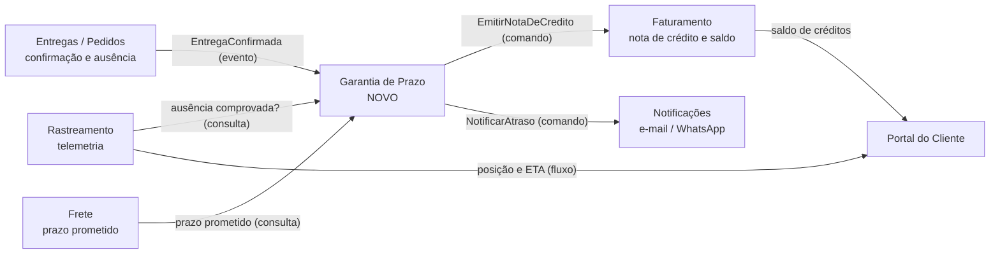

# 1. Modelagem do domínio

## Bounded contexts

Cada requisito tem **um** contexto responsável. Os demais contextos podem fornecer dados
a ele, mas não decidem a regra.

| Contexto | Responsabilidade | Requisitos sob sua responsabilidade |
|---|---|---|
| **Frete** (Python, existente) | Cotar o frete e registrar o **prazo prometido** de cada pedido | — (fornece o prazo prometido usado no RF01) |
| **Entregas** (Pedidos, Java, existente) | Registrar a **confirmação de entrega** e o **registro de ausência** do destinatário, e publicá-los sem perda | RNF01 (parte da confirmação: não tolera perda) |
| **Rastreamento** (Telemetria, existente) | Receber posições dos veículos e responder se houve **ausência comprovada** (veículo parado a até 200 m do endereço por ≥ 10 min antes do registro) | RF05, RNF01 (parte da telemetria: tolera perda) |
| **Garantia de Prazo** (novo, Python) | Medir o atraso, aplicar a política do tipo de cliente, decidir o crédito e garantir um único crédito por entrega | RF01, RF02, RF03, RF04, RF09, RNF02 |
| **Faturamento** (C#, existente) | Emitir a **nota de crédito** com número sequencial e único, e manter o saldo de créditos do cliente | RF06, RNF03 |
| **Notificações** (Node/TS, existente) | Entregar a mensagem ao cliente pelo canal preferido, com retentativa e registro da falha final | RF07, RF08 |
| **Portal do Cliente** (React, existente) | Exibir posição, previsão de chegada e saldo de créditos ao vivo | RF10 |
| Plataforma (transversal, não é contexto de negócio) | `compose.yaml` com todos os serviços | RNF04 |

> Observação sobre o RF05: a **decisão** "não há crédito" é aplicada pela Garantia de Prazo,
> mas a **regra que define ausência comprovada** (200 m, 10 min) é geoespacial e só o
> Rastreamento tem os dados para avaliá-la. Por isso o RF05 é do Rastreamento, que devolve um
> veredito (`ausenciaComprovada: true/false`) e a Garantia apenas o consome. Se a regra de
> distância mudar, só o Rastreamento muda.

## Mapa de contexto

Relações:

- **Entregas → Garantia**: *publicador / assinante*. A Garantia reage ao evento `EntregaConfirmada`; Entregas não conhece a Garantia.
- **Frete → Garantia** e **Rastreamento → Garantia**: *cliente / fornecedor*. A Garantia usa uma **camada anticorrupção** (`ClienteFrete`, `ClienteRastreamento`) para traduzir os contratos deles para a sua linguagem.
- **Garantia → Faturamento**: *cliente / fornecedor*. O Faturamento é dono da numeração; a Garantia só pede a emissão.
- **Garantia → Notificações**: *conformista*. A Garantia usa o contrato de notificação que já existe.

## Entidades e agregados

| Agregado | Raiz | Entidades e objetos de valor | Regra que protege |
|---|---|---|---|
| Garantia de Prazo | `GarantiaDoPedido` (id = `pedidoId`) | VO `PrazoPrometido`, VO `ConfirmacaoDeEntrega` (`entregaId`, data/hora), VO `Atraso` (minutos), VO `TipoDeCliente`, VO `ValorDoFrete`, entidade `CreditoConcedido` | Um pedido tem **no máximo um** crédito (RF09); crédito ≤ teto da política (RF02/RF03); sem crédito se ausência comprovada (RF05) |
| Nota de Crédito | `NotaDeCredito` | VO `NumeroDaNota` (sequencial), VO `Valor`, referência `pedidoId`, `chaveDeIdempotencia` | Número nunca repetido (RF06/RNF03); uma nota por chave de idempotência |
| Saldo de Créditos | `ContaDeCreditoDoCliente` | lista de lançamentos (`NotaDeCredito` por referência) | Saldo = soma das notas emitidas |
| Notificação | `Notificacao` | VO `Canal` (E-MAIL, WHATSAPP), VO `Tentativa` (nº, resultado) | No máximo 1 envio + 3 retentativas; falha final fica registrada (RF08) |
| Rastreamento | `Veiculo` | VO `Posicao` (lat, lon, instante), VO `Parada` | Ausência comprovada = parada ≥ 10 min a ≤ 200 m antes do registro (RF05) |

## Linguagem ubíqua

| Termo | Definição |
|---|---|
| **Prazo prometido** | Data/hora limite de entrega informada pelo serviço de Frete no momento da cotação/contratação |
| **Confirmação de entrega** | Evento registrado pelo motorista quando o destinatário recebe a carga; tem um `entregaId` único |
| **Atraso** | `confirmação − prazo prometido`, em horas (guardado em minutos no código). Se negativo, atraso = 0 |
| **Tolerância** | Faixa de atraso que não gera crédito: até 2 h, inclusive |
| **Faixa de atraso** | Intervalos `(2 h, 24 h]`, `(24 h, 72 h]` e `> 72 h`, cada um com um percentual do frete |
| **Percentual de crédito** | Varejo: 10%, 25%, 50%. Corporativo: o dobro (20%, 50%, 100%) |
| **Teto** | Crédito máximo por pedido: R$ 500 (Varejo), R$ 2.000 (Corporativo) |
| **Crédito** | Valor devolvido ao cliente = `min(frete × percentual, teto)` |
| **Cliente Varejo / Corporativo / Cortesia** | Tipos de cliente. Cortesia tem frete zero: nunca recebe crédito, mas é notificado |
| **Política de crédito** | Conjunto de faixas, percentuais e teto de um tipo de cliente |
| **Ausência comprovada** | Veículo parado a até 200 m do endereço por pelo menos 10 min antes do registro da ausência; anula o crédito |
| **Nota de crédito** | Documento emitido pelo Faturamento para cada crédito, com número sequencial único |
| **Canal preferido** | Meio escolhido pelo cliente para receber avisos: e-mail ou WhatsApp |
| **Falha final de notificação** | Envio que falhou na tentativa inicial e nas 3 retentativas; é registrado e não descartado |
