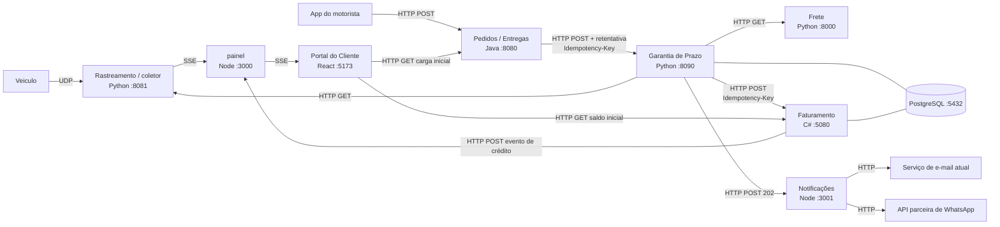

# 2. Arquitetura

## Diagrama dos serviços



## Protocolo de cada comunicação

| Origem | Destino | Protocolo | Requisito atendido | Justificativa |
|---|---|---|---|---|
| Veículo | Rastreamento | **UDP** | RNF01 | Posição a cada 30 s, perda tolerada: a próxima posição substitui a perdida. UDP não tem handshake nem retransmissão, então é mais leve para milhares de veículos |
| App do motorista | Pedidos | **HTTP POST** (sobre TCP) | RNF01, RF01 | A confirmação **não tolera perda**: TCP garante entrega e ordem, e o HTTP devolve status que o app usa para retentar |
| Pedidos | Garantia | **HTTP POST** com retentativa e cabeçalho `Idempotency-Key: entregaId` (padrão *outbox* no Pedidos) | RNF01, RNF02, RF09 | Pedidos grava a confirmação e o evento na mesma transação (outbox) e reenvia até receber 2xx. Isso dá entrega "pelo menos uma vez", que **pode duplicar**; a duplicação é resolvida pela Garantia (RF09) |
| Garantia | Frete | **HTTP GET** `/api/v1/frete/{pedidoId}/prazo` | RF01 | Consulta pontual, resposta imediata: requisição/resposta é o modelo natural |
| Garantia | Rastreamento | **HTTP GET** `/api/v1/veiculos/{id}/ausencia?endereco=…&registradoEm=…` | RF05 | Pergunta pontual com resposta sim/não. O cálculo geoespacial fica onde estão os dados |
| Garantia | Faturamento | **HTTP POST** `/api/v1/notas-credito` com `Idempotency-Key` | RF06, RF09 | Comando que precisa de confirmação (número da nota). A chave de idempotência impede segunda nota se a Garantia retentar |
| Garantia | Notificações | **HTTP POST** → `202 Accepted` | RF07, RF08, RF03 | A Garantia não espera a entrega da mensagem: o Notificações aceita e trata retentativa por conta própria, sem atrasar o crédito (RNF02) |
| Notificações | E-mail / WhatsApp | **HTTP** (API de cada fornecedor) | RF07 | São APIs externas REST; o formato diferente do WhatsApp é tratado por um Adapter |
| Rastreamento → painel → Portal | navegador | **SSE** (`text/event-stream`) | RF10 | Atualização ao vivo só do servidor para o cliente: SSE é unidirecional, roda sobre HTTP comum, reconecta sozinho (`EventSource`) e não precisa de WebSocket. Eventos: `posicao`, `previsao`, `credito` |
| Portal | Pedidos / Faturamento | **HTTP GET** | RF10 | Carga inicial da tela (dados do pedido e saldo atual) antes de o fluxo SSE começar. Exige CORS (`LOGITECH_CORS_ORIGINS`) |

## Padrões de projeto

| Ponto da solução | Padrão | Requisito | Justificativa |
|---|---|---|---|
| Cálculo do crédito por tipo de cliente | **Strategy** (`PoliticaDeCredito` com `PoliticaVarejo`, `PoliticaCorporativo`, `PoliticaCortesia`) | RF02, RF03, RF04 | Cada tipo de cliente tem faixas e teto próprios. Um tipo novo vira uma classe nova; as existentes não são tocadas (Open/Closed) |
| Escolha da política pelo tipo | **Registro / Factory** (`registrar_politica("VAREJO", PoliticaVarejo())`) | RF04 | Sem `if/elif` por tipo no calculador: o tipo novo do próximo trimestre se registra sozinho |
| Envio por WhatsApp | **Adapter** (`AdaptadorWhatsApp implements EnviadorDeNotificacao`) | RF07 | A API parceira tem formato diferente; o adaptador traduz para a interface que o Notificações já usa, e o resto do serviço não muda |
| Retentativa de envio | **Decorator** (`ComRetentativa(enviador, maxRetentativas=3)`) | RF08 | Retentativa é comportamento que se empilha por fora do enviador, igual ao Decorator da Aula 06. Na falha final grava em `notificacoes_falhas` e emite alerta (não descarta) |
| Acesso a Frete e Rastreamento | **Adapter / camada anticorrupção** (`ClienteFrete`, `ClienteRastreamento` como `Protocol`) | RF01, RF05 | Isola a Garantia dos contratos externos e permite Stub/Mock nos testes de unidade |
| Persistência do crédito | **Repository** (`RepositorioDeCreditos`) | RF09 | Esconde o SQL do domínio; permite um Fake em memória nos testes |
| Atualização ao vivo do Portal | **Observer** (SSE + `EventSource` / RxJS) | RF10 | O painel é o sujeito; cada aba do Portal é um observador que se inscreve e cancela a inscrição (teardown) ao sair |

### Ponto onde a dupla decidiu não aplicar padrão

**Numeração da nota de crédito: não usar Singleton.** Um gerador de números Singleton parece a
escolha óbvia ("uma única instância que conta"), mas ele só é único **dentro de um processo**. Com
duas réplicas do Faturamento em contêiner, cada uma teria o seu Singleton e os números se
repetiriam, violando o RNF03. A garantia vem do banco (ver abaixo), que é o único ponto
compartilhado entre réplicas.

**Faixas de atraso: não usar Chain of Responsibility nem uma classe por faixa.** As faixas
(2 h, 24 h, 72 h) são **dados**, não comportamento: dentro de uma política, só mudam os limites e os
percentuais. Uma tabela ordenada `[(120 min, 0%), (1440 min, 10%), …]` é mais legível e mais fácil
de testar do que uma cadeia de objetos.

## Confirmação de entrega duplicada (RF09)

A garantia fica no **banco da Garantia de Prazo**, e não só no código, porque o código pode rodar
em duas réplicas ao mesmo tempo:

```sql
CREATE TABLE garantia.creditos (
  id           bigserial PRIMARY KEY,
  pedido_id    varchar(36) NOT NULL,
  entrega_id   varchar(36) NOT NULL UNIQUE,   
  valor        numeric(12,2) NOT NULL,
  nota_numero  bigint,
  criado_em    timestamptz NOT NULL DEFAULT now()
);

INSERT INTO garantia.creditos (pedido_id, entrega_id, valor)
VALUES ($1, $2, $3)
ON CONFLICT (entrega_id) DO NOTHING
RETURNING id;   -- sem linha devolvida = duplicata: responde 200 e não emite nota
```

1. O Pedidos envia `Idempotency-Key: entregaId`.
2. A Garantia faz o `INSERT … ON CONFLICT DO NOTHING`. Só quem inseriu segue para emitir a nota.
3. A chamada ao Faturamento usa a mesma chave, e o Faturamento tem `UNIQUE (chave_idempotencia)`.
   Se a Garantia cair entre o INSERT e a emissão e retentar, não sai uma segunda nota.

## Numeração das notas de crédito (RF06 e RNF03)

```sql
CREATE SEQUENCE faturamento.seq_nota_credito;

CREATE TABLE faturamento.notas_credito (
  numero              bigint PRIMARY KEY DEFAULT nextval('faturamento.seq_nota_credito'),
  chave_idempotencia  varchar(36) NOT NULL UNIQUE,
  pedido_id           varchar(36) NOT NULL,
  valor               numeric(12,2) NOT NULL,
  emitida_em          timestamptz NOT NULL DEFAULT now()
);
```

- `nextval` é **atômico** no PostgreSQL: duas transações concorrentes nunca recebem o mesmo número,
  em qualquer número de réplicas. A `PRIMARY KEY` é a segunda barreira: mesmo com defeito no
  código, um número repetido é recusado pelo banco.
- Trade-off: uma sequência pode deixar **lacunas** (transação que faz rollback consome o número).
  "Sequencial e nunca repetido" é atendido; se o negócio exigir **sem lacunas**, a alternativa é
  uma tabela-contador com `SELECT … FOR UPDATE`, que serializa as emissões e custa vazão.
- Verificação: teste de integração CT18 dispara 1.000 emissões concorrentes e confere
  `COUNT(DISTINCT numero) = 1000`.

## Execução em contêineres (RNF04)

```yaml
services:
  postgres:
    image: postgres:16
    environment: { POSTGRES_USER: logitech, POSTGRES_PASSWORD: logitech, POSTGRES_DB: logitech }
    ports: ["5432:5432"]
    volumes: [dados:/var/lib/postgresql/data]
    healthcheck: { test: ["CMD-SHELL", "pg_isready -U logitech"], interval: 5s, retries: 10 }

  coletor:            
    build: ./servicos/coletor
    ports: ["9999:9999/udp", "8081:8081"]

  pedidos:
    build: ./servicos/pedidos
    ports: ["8080:8080"]
    depends_on: { postgres: { condition: service_healthy } }
    environment: { GARANTIA_URL: http://garantia:8090 }

  frete:
    build: ./servicos/frete
    ports: ["8000:8000"]

  garantia:         
    build: ./servicos/garantia
    ports: ["8090:8090"]
    depends_on:
      postgres: { condition: service_healthy }
      frete: { condition: service_started }
      faturamento: { condition: service_started }
    environment:
      FRETE_URL: http://frete:8000
      RASTREAMENTO_URL: http://coletor:8081
      FATURAMENTO_URL: http://faturamento:5080
      NOTIFICACOES_URL: http://notificacoes:3001

  faturamento:
    build: ./servicos/faturamento
    ports: ["5080:5080"]
    depends_on: { postgres: { condition: service_healthy } }
    environment: { LOGITECH_CORS_ORIGINS: http://localhost:5173 }

  notificacoes:
    build: ./servicos/notificacoes
    ports: ["3001:3001"]

  painel:         
    build: ./servicos/painel
    ports: ["3000:3000"]
    environment: { LOGITECH_CORS_ORIGINS: http://localhost:5173 }

  portal:
    build: ./portal
    ports: ["5173:5173"]

volumes:
  dados:
```

Todos os serviços HTTP expõem `GET /health`, que pode ser usado no `healthcheck` de cada um. Oconjunto sobe com `docker compose up -d --wait`.